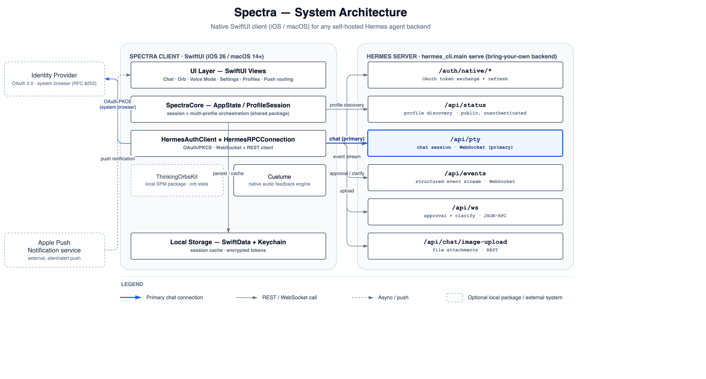

# Spectra

Native SwiftUI client (iOS / macOS) for any self-hosted Hermes agent backend. Point it at your own `hermes_cli.main serve` instance and get a real app instead of a text thread — no hosted service, no vendor lock-in, bring your own backend.



## What it does

- **Native OAuth** via system browser (PKCE, RFC 8252) — no embedded webview, no stored passwords
- **Live chat** over a dedicated WebSocket (`/api/pty`), with detach/reattach and a 30-minute session buffer
- **Structured agent events** (`/api/events`) drive an ambient orb UI via [ThinkingOrbsKit](docs/adr/0001-thinkingorbskit-as-local-package.md)
- **Approval & clarify flows** as JSON-RPC (`/api/ws`) — dynamic, server-driven choice sets, not a fixed yes/no
- **File attachments**, **push notifications**, and **native audio feedback** (via the bundled Cuelume engine)
- **Multi-profile sessions** — run several agent profiles side by side, each with its own live connection
- Local persistence via **SwiftData**, tokens in **Keychain**

## Requirements

- Xcode 26+, iOS 26 / macOS 14+ targets
- A running `hermes_cli.main serve` instance to point the client at

## Build & run

Open `spectra-app.xcodeproj` in Xcode, select the `spectra-app` scheme, and run.

To build + launch + screenshot on the iOS Simulator from the command line:

```sh
./run.sh [output-screenshot-path]
```

## Project layout

- `spectra-app/` — the SwiftUI app target (Views, entry point)
- `SpectraCore/` — shared Swift package: auth, networking (`HermesRPCConnection`), state (`AppState`, `ProfileSession`), persistence, models
- `spectra-appTests/`, `spectra-appUITests/` — unit and UI test targets
- `docs/adr/` — architecture decision records
- `docs/dev-log/` — session-by-session build notes

See [`docs/spectra-architecture.drawio`](docs/spectra-architecture.drawio) for the editable diagram source.

## License

MIT — see [LICENSE](LICENSE).
